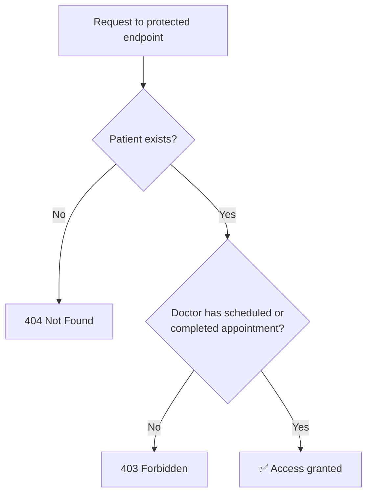

# DoctorOS-AI — Frontend API Contract

> **Version:** 1.0  
> **Backend:** FastAPI (Python)  
> **Last Updated:** 2025-07-15  
> **Purpose:** Complete integration reference for frontend developers building against the DoctorOS-AI backend.

---

## Table of Contents

- [Base URL & CORS](#base-url--cors)
- [Authentication](#authentication)
- [Endpoint Reference](#endpoint-reference)
  - [Health Check](#1-health-check)
  - [Auth — Login](#2-auth--login)
  - [Doctor Dashboard](#3-doctor-dashboard)
  - [Patients — List](#4-patients--list)
  - [Patients — Create](#5-patients--create)
  - [Patients — Get by ID](#6-patients--get-by-id)
  - [Patient Timeline](#7-patient-timeline)
  - [Appointments — Create](#8-appointments--create)
  - [Appointments — Update Status](#9-appointments--update-status)
  - [Visits — Create](#10-visits--create)
  - [Documents — Upload](#11-documents--upload)
  - [Documents — Trigger OCR](#12-documents--trigger-ocr)
  - [Review — Get Pending](#13-review--get-pending-extractions)
  - [Review — Edit Entity](#14-review--edit-entity)
  - [Review — Edit Lab Result](#15-review--edit-lab-result)
  - [Review — Entity Decision](#16-review--entity-decision)
  - [Review — Lab Result Decision](#17-review--lab-result-decision)
  - [RAG — Ask Question](#18-rag--ask-patient-question)
  - [Chat — Send Message](#19-chat--send-message)
  - [Chat — List Conversations](#20-chat--list-conversations)
  - [Chat — Get Conversation Detail](#21-chat--get-conversation-detail)
  - [Summary — Generate](#22-summary--generate)
  - [Summary — Get](#23-summary--get-existing)
- [Patient Authorization Model](#patient-authorization-model)
- [Error Handling](#error-handling)
- [File Upload Convention](#file-upload-convention)
- [Frontend Integration Patterns](#frontend-integration-patterns)
- [Important Caveats & Missing Endpoints](#important-caveats--missing-endpoints)

---

## Base URL & CORS

| Environment | Base URL |
|---|---|
| Local development | `http://localhost:8000` |

**Allowed CORS origins:**

```
http://localhost:3000
http://127.0.0.1:3000
http://localhost:5173
http://127.0.0.1:5173
```

All API calls from the frontend should use `BASE_URL + endpoint_path`.

---

## Authentication

| Property | Value |
|---|---|
| Method | OAuth2 with Bearer JWT |
| Token type | `bearer` |
| Algorithm | HS256 |
| Token expiry | **30 minutes** (configurable via `ACCESS_TOKEN_EXPIRE_MINUTES`) |
| Header format | `Authorization: Bearer {access_token}` |
| Login data format | **Form data** (`application/x-www-form-urlencoded`), NOT JSON |

**JWT payload structure:**

```json
{
  "sub": "42",
  "exp": 1700000000
}
```

- `sub` — the doctor's user ID as a **string**
- `exp` — UNIX timestamp of token expiry

> [!IMPORTANT]
> There is **no registration endpoint**. Doctor accounts are created via the CLI script `create_doctor.py`.

### Token Lifecycle

1. User submits email + password via the login form.
2. Frontend sends a `POST /auth/login` with form-encoded data.
3. Backend returns `{"access_token": "...", "token_type": "bearer"}`.
4. Frontend stores the token (memory, `localStorage`, or secure cookie) and attaches it to every subsequent request as `Authorization: Bearer {token}`.
5. On **401 Unauthorized**, redirect the user to the login screen.

---

## Endpoint Reference

### 1. Health Check

```
GET /health
```

**Auth:** None

**Response** `200 OK`:

```json
{
  "status": "healthy",
  "application": "DoctorOS AI",
  "message": "Backend is running successfully"
}
```

**Use case:** Connection check on app load, monitoring, readiness probe.

---

### 2. Auth — Login

```
POST /auth/login
```

**Auth:** None  
**Content-Type:** `application/x-www-form-urlencoded`

> [!WARNING]
> This endpoint uses OAuth2PasswordRequestForm and expects **form data**, not JSON. The field is `username` (which accepts the doctor's **email**), not `email`.

**Request body (form fields):**

| Field | Type | Required | Description |
|---|---|---|---|
| `username` | string | ✅ | Doctor's email address |
| `password` | string | ✅ | Doctor's password |

**Example — JavaScript `fetch`:**

```js
const formData = new URLSearchParams();
formData.append("username", "dr.smith@clinic.com");
formData.append("password", "securepassword123");

const response = await fetch(`${BASE_URL}/auth/login`, {
  method: "POST",
  headers: { "Content-Type": "application/x-www-form-urlencoded" },
  body: formData,
});
```

**Example — Axios:**

```js
const response = await axios.post(`${BASE_URL}/auth/login`, 
  new URLSearchParams({ username: "dr.smith@clinic.com", password: "securepassword123" }),
  { headers: { "Content-Type": "application/x-www-form-urlencoded" } }
);
```

**Response** `200 OK`:

```json
{
  "access_token": "eyJhbGciOiJIUzI1NiIsInR5cCI6IkpXVCJ9...",
  "token_type": "bearer"
}
```

**Errors:**

| Status | Detail |
|---|---|
| 401 | `"Invalid email or password"` |

---

### 3. Doctor Dashboard

```
GET /doctor/dashboard
```

**Auth:** ✅ Required (role: `doctor`)

**Response** `200 OK`:

```json
{
  "message": "Doctor access granted",
  "doctor_id": 1,
  "doctor_name": "Dr. Alice Smith",
  "role": "doctor"
}
```

**Use case:** Verify auth on page load, populate header/profile info.

---

### 4. Patients — List

```
GET /patients/
```

**Auth:** ✅ Required (role: `doctor`)

**Query parameters:**

| Param | Type | Default | Constraints | Description |
|---|---|---|---|---|
| `search` | string \| null | `null` | min length 1 | Filter patients by name (partial match) |
| `skip` | int | `0` | ≥ 0 | Pagination offset |
| `limit` | int | `10` | 1–100 | Page size |

**Example request:**

```
GET /patients/?search=john&skip=0&limit=20
```

**Response** `200 OK`:

```json
{
  "items": [
    {
      "id": 1,
      "patient_uid": "DOS-2025-000001",
      "name": "John Doe",
      "dob": "1985-06-15",
      "gender": "Male",
      "phone": "9876543210",
      "email": "john.doe@email.com",
      "address": "123 Main St, Springfield",
      "blood_group": "O+",
      "emergency_contact": "Jane Doe - 9876543211"
    }
  ],
  "total": 1,
  "skip": 0,
  "limit": 20
}
```

**Schema — `PatientResponse`:**

| Field | Type | Nullable | Description |
|---|---|---|---|
| `id` | int | — | Internal primary key |
| `patient_uid` | string | — | Public UID, format: `DOS-{YYYY}-{ID:06d}` |
| `name` | string | — | Patient full name |
| `dob` | date | ✅ | Date of birth (`YYYY-MM-DD`) |
| `gender` | string | ✅ | Gender |
| `phone` | string | ✅ | Phone number |
| `email` | string | ✅ | Email address |
| `address` | string | ✅ | Postal address |
| `blood_group` | string | ✅ | Blood group |
| `emergency_contact` | string | ✅ | Emergency contact info |

---

### 5. Patients — Create

```
POST /patients/
```

**Auth:** ✅ Required (role: `doctor`)  
**Content-Type:** `application/json`

**Request body — `PatientCreate`:**

| Field | Type | Required | Constraints | Description |
|---|---|---|---|---|
| `name` | string | ✅ | 2–150 chars | Patient full name |
| `dob` | date \| null | — | — | Date of birth |
| `gender` | string \| null | — | max 30 chars | Gender |
| `phone` | string \| null | — | max 20 chars, 7–15 digits | Phone number |
| `email` | EmailStr \| null | — | valid email | Email address |
| `address` | string \| null | — | — | Postal address |
| `blood_group` | string \| null | — | max 10 chars | Blood group |
| `emergency_contact` | string \| null | — | max 100 chars | Emergency contact |

**Example request:**

```json
{
  "name": "Priya Patel",
  "dob": "1992-03-20",
  "gender": "Female",
  "phone": "9123456789",
  "email": "priya.patel@email.com",
  "address": "45 Park Avenue, Mumbai",
  "blood_group": "B+",
  "emergency_contact": "Raj Patel - 9123456780"
}
```

**Response** `201 Created`:

```json
{
  "id": 2,
  "patient_uid": "DOS-2025-000002",
  "name": "Priya Patel",
  "dob": "1992-03-20",
  "gender": "Female",
  "phone": "9123456789",
  "email": "priya.patel@email.com",
  "address": "45 Park Avenue, Mumbai",
  "blood_group": "B+",
  "emergency_contact": "Raj Patel - 9123456780"
}
```

> [!NOTE]
> The `patient_uid` is auto-generated by the backend in the format `DOS-{YYYY}-{ID:06d}`. Do not send it in the request.

---

### 6. Patients — Get by ID

```
GET /patients/{patient_id}
```

**Auth:** ✅ Required (role: `doctor`)

**Path parameters:**

| Param | Type | Description |
|---|---|---|
| `patient_id` | int | Patient's internal ID |

**Response** `200 OK`:

```json
{
  "id": 1,
  "patient_uid": "DOS-2025-000001",
  "name": "John Doe",
  "dob": "1985-06-15",
  "gender": "Male",
  "phone": "9876543210",
  "email": "john.doe@email.com",
  "address": "123 Main St, Springfield",
  "blood_group": "O+",
  "emergency_contact": "Jane Doe - 9876543211"
}
```

> [!NOTE]
> This endpoint returns the patient object directly, not wrapped in the `PatientResponse` schema. The shape is effectively the same but be aware of potential subtle differences in serialization.

**Errors:**

| Status | Detail |
|---|---|
| 404 | `"Patient not found"` |

---

### 7. Patient Timeline

```
GET /patients/{patient_id}/timeline
```

**Auth:** ✅ Required (role: `doctor`)

**Response** `200 OK`:

```json
{
  "patient_id": 1,
  "patient_uid": "DOS-2025-000001",
  "patient_name": "John Doe",
  "total_records": 3,
  "timeline": [
    {
      "type": "visit",
      "id": 10,
      "date": "2025-07-10T09:30:00",
      "appointment_id": 5,
      "doctor_id": 1,
      "observations": "Patient reports mild cough for 3 days",
      "diagnosis": "Upper respiratory infection",
      "prescription_notes": "Rest and fluids recommended",
      "medications": [
        {
          "id": 1,
          "drug": "Amoxicillin",
          "dose": "500mg",
          "frequency": "3 times daily",
          "duration": "7 days",
          "instructions": "Take after meals"
        }
      ]
    },
    {
      "type": "document",
      "id": 3,
      "date": "2025-07-08T14:20:00",
      "document_type": "pdf",
      "ocr_status": "completed"
    },
    {
      "type": "lab_result",
      "id": 7,
      "date": "2025-07-08",
      "document_id": 3,
      "test_name": "Hemoglobin",
      "value": 13.5,
      "unit": "g/dL",
      "ref_range": "12.0-17.5"
    }
  ]
}
```

**Timeline record types:**

| `type` | Key Fields |
|---|---|
| `"visit"` | `id`, `date` (datetime), `appointment_id` (nullable), `doctor_id`, `observations`, `diagnosis`, `prescription_notes`, `medications[]` |
| `"document"` | `id`, `date` (datetime), `document_type`, `ocr_status` |
| `"lab_result"` | `id`, `date` (date, nullable), `document_id` (nullable), `test_name`, `value` (float), `unit`, `ref_range` |

**Frontend pattern:** Use the `type` field to render different card components for each timeline entry.

---

### 8. Appointments — Create

```
POST /appointments/
```

**Auth:** ✅ Required (role: `doctor`)  
**Content-Type:** `application/json`

**Request body — `AppointmentCreate`:**

| Field | Type | Required | Constraints | Description |
|---|---|---|---|---|
| `patient_id` | int | ✅ | > 0 | Patient's internal ID |
| `appointment_datetime` | datetime | ✅ | Must be in the **future**; must include **timezone** | Scheduled date and time |
| `duration_minutes` | int | — | `15`, `30`, or `60` (default: `30`) | Duration |
| `reason` | string \| null | — | max 1000 chars | Reason for visit |

> [!WARNING]
> `appointment_datetime` **must include a timezone offset** (e.g., `2025-08-01T10:00:00+05:30`). The backend will reject requests with naive datetimes. The datetime must also be in the future.

**Example request:**

```json
{
  "patient_id": 1,
  "appointment_datetime": "2025-08-01T10:00:00+05:30",
  "duration_minutes": 30,
  "reason": "Follow-up for respiratory infection"
}
```

**Response** `201 Created` — `AppointmentResponse`:

```json
{
  "id": 6,
  "patient_id": 1,
  "doctor_id": 1,
  "appointment_datetime": "2025-08-01T10:00:00+05:30",
  "duration_minutes": 30,
  "status": "scheduled",
  "reason": "Follow-up for respiratory infection"
}
```

**Errors:**

| Status | Detail |
|---|---|
| 404 | `"Patient not found"` |
| 409 | `"Scheduling conflict — overlapping appointment"` |

---

### 9. Appointments — Update Status

```
PATCH /appointments/{appointment_id}/status
```

**Auth:** ✅ Required (role: `doctor`)  
**Content-Type:** `application/json`

**Path parameters:**

| Param | Type | Description |
|---|---|---|
| `appointment_id` | int | Appointment ID |

**Request body:**

```json
{
  "status": "completed"
}
```

**Allowed status values:** `"completed"` | `"cancelled"` | `"no-show"`

> [!IMPORTANT]
> Only appointments with status `"scheduled"` can be updated. Attempting to update an already-completed, cancelled, or no-show appointment will fail.

**Response** `200 OK`:

```json
{
  "id": 6,
  "patient_id": 1,
  "doctor_id": 1,
  "appointment_datetime": "2025-08-01T10:00:00+05:30",
  "duration_minutes": 30,
  "status": "completed",
  "reason": "Follow-up for respiratory infection"
}
```

**Errors:**

| Status | Detail |
|---|---|
| 404 | `"Appointment not found"` |
| 400 | `"Only scheduled appointments can be updated"` |

---

### 10. Visits — Create

```
POST /visits/
```

**Auth:** ✅ Required (role: `doctor`)  
**Content-Type:** `application/json`

**Request body — `VisitCreate`:**

| Field | Type | Required | Constraints | Description |
|---|---|---|---|---|
| `patient_id` | int | ✅ | > 0 | Patient ID |
| `appointment_id` | int \| null | — | > 0 | Link to appointment (optional) |
| `observations` | string \| null | — | — | Clinical observations |
| `diagnosis` | string \| null | — | — | Diagnosis |
| `prescription_notes` | string \| null | — | — | Prescription notes |
| `visit_date` | datetime | ✅ | — | Date/time of the visit |
| `medications` | MedicationCreate[] | — | — | List of prescribed medications |

**`MedicationCreate` schema:**

| Field | Type | Required | Constraints |
|---|---|---|---|
| `drug` | string | ✅ | 1–200 chars |
| `dose` | string \| null | — | max 100 chars |
| `frequency` | string \| null | — | max 100 chars |
| `duration` | string \| null | — | max 100 chars |
| `instructions` | string \| null | — | — |

**Example request:**

```json
{
  "patient_id": 1,
  "appointment_id": 6,
  "observations": "Cough subsiding. Lungs clear on auscultation.",
  "diagnosis": "Resolving upper respiratory infection",
  "prescription_notes": "Continue rest. No new medication needed.",
  "visit_date": "2025-08-01T10:30:00+05:30",
  "medications": [
    {
      "drug": "Cetirizine",
      "dose": "10mg",
      "frequency": "Once daily",
      "duration": "5 days",
      "instructions": "Take at bedtime"
    }
  ]
}
```

**Response** `201 Created` — `VisitResponse`:

```json
{
  "id": 11,
  "appointment_id": 6,
  "patient_id": 1,
  "doctor_id": 1,
  "observations": "Cough subsiding. Lungs clear on auscultation.",
  "diagnosis": "Resolving upper respiratory infection",
  "prescription_notes": "Continue rest. No new medication needed.",
  "visit_date": "2025-08-01T10:30:00+05:30",
  "medications": [
    {
      "id": 2,
      "drug": "Cetirizine",
      "dose": "10mg",
      "frequency": "Once daily",
      "duration": "5 days",
      "instructions": "Take at bedtime"
    }
  ]
}
```

---

### 11. Documents — Upload

```
POST /documents/upload/{patient_id}
```

**Auth:** ✅ Required (role: `doctor`)  
**Content-Type:** `multipart/form-data`

**Path parameters:**

| Param | Type | Description |
|---|---|---|
| `patient_id` | int | Patient ID |

**Form field:**

| Field | Type | Constraints |
|---|---|---|
| `file` | File | PDF, PNG, JPG, or JPEG; max **10 MB** |

**Example — JavaScript `fetch`:**

```js
const formData = new FormData();
formData.append("file", fileInput.files[0]);

const response = await fetch(`${BASE_URL}/documents/upload/${patientId}`, {
  method: "POST",
  headers: {
    Authorization: `Bearer ${token}`,
    // Do NOT set Content-Type — the browser sets it with the boundary
  },
  body: formData,
});
```

**Example — Axios:**

```js
const formData = new FormData();
formData.append("file", file);

const response = await axios.post(
  `${BASE_URL}/documents/upload/${patientId}`,
  formData,
  {
    headers: {
      Authorization: `Bearer ${token}`,
      "Content-Type": "multipart/form-data",
    },
  }
);
```

**Response** `201 Created` — `DocumentUploadResponse`:

```json
{
  "id": 4,
  "patient_id": 1,
  "document_type": "pdf",
  "ocr_status": "pending",
  "uploaded_at": "2025-07-15T12:00:00"
}
```

> [!NOTE]
> OCR processing runs **in the background** after upload. The initial `ocr_status` will be `"pending"`. Poll the timeline or use the manual OCR trigger to check/reprocess.

**Errors:**

| Status | Detail |
|---|---|
| 400 | `"File type not allowed"` or `"File too large"` |
| 404 | `"Patient not found"` |

---

### 12. Documents — Trigger OCR

```
POST /documents/{document_id}/process-ocr
```

**Auth:** ✅ Required (role: `doctor`)

**Path parameters:**

| Param | Type | Description |
|---|---|---|
| `document_id` | int | Document ID |

**Response** `200 OK`:

```json
{
  "message": "OCR processing completed successfully",
  "document_id": 4,
  "ocr_status": "completed",
  "extraction_status": "completed",
  "success": true,
  "entities_saved": 5,
  "lab_results_saved": 3
}
```

**Use case:** Manually re-trigger OCR if automatic processing failed or if the doctor wants to reprocess a document.

---

### 13. Review — Get Pending Extractions

```
GET /review/pending/{document_id}
```

**Auth:** ✅ Required (role: `doctor`)

**Response** `200 OK`:

```json
{
  "document_id": 4,
  "patient_id": 1,
  "entities": [
    {
      "id": 12,
      "entity_type": "condition",
      "value": "Hypertension",
      "unit": null,
      "confidence": 0.92,
      "review_status": "pending"
    }
  ],
  "lab_results": [
    {
      "id": 8,
      "test_name": "Blood Glucose (Fasting)",
      "value": 110.0,
      "unit": "mg/dL",
      "ref_range": "70-100",
      "test_date": "2025-07-05",
      "confidence": 0.88,
      "review_status": "pending"
    }
  ],
  "total_pending": 2
}
```

---

### 14. Review — Edit Entity

```
PATCH /review/entities/{entity_id}
```

**Auth:** ✅ Required (role: `doctor`)  
**Content-Type:** `application/json`

**Request body (all fields optional):**

| Field | Type | Constraints |
|---|---|---|
| `value` | string \| null | max 500 chars |
| `unit` | string \| null | max 50 chars |

**Example request:**

```json
{
  "value": "Essential Hypertension",
  "unit": null
}
```

**Response** `200 OK`:

```json
{
  "message": "Entity updated successfully",
  "entity_id": 12,
  "value": "Essential Hypertension",
  "unit": null,
  "review_status": "pending"
}
```

---

### 15. Review — Edit Lab Result

```
PATCH /review/lab-results/{lab_id}
```

**Auth:** ✅ Required (role: `doctor`)  
**Content-Type:** `application/json`

**Request body (all fields optional):**

| Field | Type | Constraints |
|---|---|---|
| `test_name` | string \| null | max 200 chars |
| `value` | float \| null | — |
| `unit` | string \| null | max 50 chars |
| `ref_range` | string \| null | max 100 chars |
| `test_date` | date \| null | `YYYY-MM-DD` |

**Example request:**

```json
{
  "test_name": "Fasting Blood Glucose",
  "value": 108.5,
  "ref_range": "70-100"
}
```

**Response** `200 OK`:

```json
{
  "message": "Lab result updated successfully",
  "lab_id": 8,
  "test_name": "Fasting Blood Glucose",
  "value": 108.5,
  "unit": "mg/dL",
  "ref_range": "70-100",
  "test_date": "2025-07-05",
  "review_status": "pending"
}
```

---

### 16. Review — Entity Decision

```
POST /review/entities/{entity_id}/decision
```

**Auth:** ✅ Required (role: `doctor`)  
**Content-Type:** `application/json`

**Request body:**

```json
{
  "decision": "approved"
}
```

**Allowed values:** `"approved"` | `"rejected"`

**Response** `200 OK`:

```json
{
  "message": "Entity approved successfully",
  "entity_id": 12,
  "review_status": "approved",
  "needs_review": false,
  "reviewed_by": 1,
  "reviewed_at": "2025-07-15T12:30:00"
}
```

---

### 17. Review — Lab Result Decision

```
POST /review/lab-results/{lab_id}/decision
```

**Auth:** ✅ Required (role: `doctor`)  
**Content-Type:** `application/json`

**Request body:**

```json
{
  "decision": "approved"
}
```

**Allowed values:** `"approved"` | `"rejected"`

**Response** `200 OK`:

```json
{
  "message": "Lab result approved successfully",
  "lab_id": 8,
  "review_status": "approved",
  "needs_review": false,
  "reviewed_by": 1,
  "reviewed_at": "2025-07-15T12:35:00"
}
```

---

### 18. RAG — Ask Patient Question

```
POST /patients/{patient_id}/ask
```

**Auth:** ✅ Required + [Patient Authorization](#patient-authorization-model)  
**Content-Type:** `application/json`

**Request body — `RAGAskRequest`:**

| Field | Type | Required | Constraints |
|---|---|---|---|
| `question` | string | ✅ | 1–2000 chars |

**Example request:**

```json
{
  "question": "What were the patient's last blood glucose readings?"
}
```

**Response** `200 OK` — `RAGAskResponse`:

```json
{
  "answer": "The patient's most recent fasting blood glucose was 110 mg/dL (recorded on 2025-07-05), which is slightly above the reference range of 70-100 mg/dL.",
  "citations": [
    {
      "source_id": "doc_4_chunk_2",
      "chunk_id": 15,
      "document_id": 4,
      "patient_id": 1,
      "chunk_index": 2,
      "page_no": 1,
      "document_date": "2025-07-05"
    }
  ],
  "retrieved_chunks": 3
}
```

**`RAGCitation` schema:**

| Field | Type | Description |
|---|---|---|
| `source_id` | string | Unique source identifier |
| `chunk_id` | int | Chunk primary key |
| `document_id` | int | Source document ID |
| `patient_id` | int | Patient ID |
| `chunk_index` | int | Chunk position within document |
| `page_no` | int \| null | Page number in source document |
| `document_date` | string | Date of the source document |

---

### 19. Chat — Send Message

```
POST /patients/{patient_id}/chat
```

**Auth:** ✅ Required + [Patient Authorization](#patient-authorization-model)  
**Content-Type:** `application/json`

**Request body — `ChatRequest`:**

| Field | Type | Required | Constraints | Description |
|---|---|---|---|---|
| `question` | string | ✅ | 1–2000 chars | User's message |
| `conversation_id` | int \| null | — | > 0 | Existing conversation ID to continue; `null` starts a new conversation |

**Example — Start new conversation:**

```json
{
  "question": "Summarize this patient's medical history",
  "conversation_id": null
}
```

**Example — Continue existing conversation:**

```json
{
  "question": "What about allergies?",
  "conversation_id": 3
}
```

**Response** `200 OK` — `ChatResponse`:

```json
{
  "conversation": {
    "id": 3,
    "patient_id": 1,
    "doctor_id": 1,
    "title": "Summarize this patient's medical history",
    "created_at": "2025-07-15T13:00:00",
    "updated_at": "2025-07-15T13:00:05"
  },
  "user_message": {
    "id": 20,
    "role": "user",
    "content": "Summarize this patient's medical history",
    "citations": [],
    "created_at": "2025-07-15T13:00:00"
  },
  "assistant_message": {
    "id": 21,
    "role": "assistant",
    "content": "Based on the available records, John Doe has been treated for...",
    "citations": [
      {
        "source_id": "doc_4_chunk_1",
        "chunk_id": 14,
        "document_id": 4,
        "patient_id": 1,
        "chunk_index": 1,
        "page_no": 1,
        "document_date": "2025-07-05"
      }
    ],
    "created_at": "2025-07-15T13:00:05"
  }
}
```

> [!NOTE]
> Conversation title is **auto-generated** from the first question, truncated to **60 characters**.

---

### 20. Chat — List Conversations

```
GET /patients/{patient_id}/conversations
```

**Auth:** ✅ Required + [Patient Authorization](#patient-authorization-model)

**Query parameters:**

| Param | Type | Default | Constraints |
|---|---|---|---|
| `skip` | int | `0` | ≥ 0 |
| `limit` | int | `20` | 1–100 |

**Response** `200 OK` — `ConversationHistoryResponse`:

```json
{
  "conversations": [
    {
      "id": 3,
      "patient_id": 1,
      "doctor_id": 1,
      "title": "Summarize this patient's medical history",
      "created_at": "2025-07-15T13:00:00",
      "updated_at": "2025-07-15T13:05:00"
    }
  ],
  "total": 1
}
```

---

### 21. Chat — Get Conversation Detail

```
GET /patients/{patient_id}/conversations/{conversation_id}
```

**Auth:** ✅ Required + [Patient Authorization](#patient-authorization-model)

**Response** `200 OK` — `ConversationDetailResponse`:

```json
{
  "id": 3,
  "patient_id": 1,
  "doctor_id": 1,
  "title": "Summarize this patient's medical history",
  "created_at": "2025-07-15T13:00:00",
  "updated_at": "2025-07-15T13:05:00",
  "messages": [
    {
      "id": 20,
      "role": "user",
      "content": "Summarize this patient's medical history",
      "citations": [],
      "created_at": "2025-07-15T13:00:00"
    },
    {
      "id": 21,
      "role": "assistant",
      "content": "Based on the available records, John Doe has been treated for...",
      "citations": [
        {
          "source_id": "doc_4_chunk_1",
          "chunk_id": 14,
          "document_id": 4,
          "patient_id": 1,
          "chunk_index": 1,
          "page_no": 1,
          "document_date": "2025-07-05"
        }
      ],
      "created_at": "2025-07-15T13:00:05"
    }
  ]
}
```

---

### 22. Summary — Generate

```
POST /patients/{patient_id}/summary
```

**Auth:** ✅ Required + [Patient Authorization](#patient-authorization-model)  
**Content-Type:** `application/json`

**Request body:**

| Field | Type | Default | Description |
|---|---|---|---|
| `force_regenerate` | bool | `false` | If `true`, regenerates the summary even if one exists |

**Example request:**

```json
{
  "force_regenerate": false
}
```

**Response** `200 OK` — `PatientSummaryResponse`:

```json
{
  "id": 1,
  "patient_id": 1,
  "doctor_id": 1,
  "summary": "John Doe is a 40-year-old male with a history of upper respiratory infections. Recent lab work shows slightly elevated fasting blood glucose (110 mg/dL). Current medications include Amoxicillin and Cetirizine.",
  "citations": [
    {
      "record_type": "visit",
      "record_id": 10,
      "date": "2025-07-10",
      "document_id": null
    },
    {
      "record_type": "lab_result",
      "record_id": 7,
      "date": "2025-07-08",
      "document_id": 3
    }
  ],
  "generated_at": "2025-07-15T14:00:00"
}
```

**`PatientSummaryCitation` schema:**

| Field | Type | Description |
|---|---|---|
| `record_type` | string | Source record type (`"visit"`, `"lab_result"`, etc.) |
| `record_id` | int | ID of the source record |
| `date` | string \| null | Date of the source record |
| `document_id` | int \| null | Associated document ID (if applicable) |

---

### 23. Summary — Get Existing

```
GET /patients/{patient_id}/summary
```

**Auth:** ✅ Required + [Patient Authorization](#patient-authorization-model)

**Response** `200 OK` — returns `PatientSummaryResponse` (same schema as above).

**Errors:**

| Status | Detail |
|---|---|
| 404 | `"No summary found for this patient"` |

---

## Patient Authorization Model

Certain endpoints enforce an additional authorization check beyond basic JWT authentication:

**Affected endpoints:**

- `POST /patients/{patient_id}/ask`
- `POST /patients/{patient_id}/chat`
- `GET /patients/{patient_id}/conversations`
- `GET /patients/{patient_id}/conversations/{conversation_id}`
- `POST /patients/{patient_id}/summary`
- `GET /patients/{patient_id}/summary`

**Rules (enforced by `get_authorized_patient` dependency):**

1. The patient must exist → **404** if not found.
2. The authenticated doctor must have at least one appointment with the patient where `status` is `"scheduled"` or `"completed"` → **403** if no qualifying appointment exists.
3. Appointments with status `"cancelled"` or `"no-show"` **do NOT** grant access.



**Frontend implication:** Before navigating to patient chat, RAG, or summary pages, ensure the doctor has an active (scheduled/completed) appointment with that patient. Display appropriate UI messages when 403 is returned.

---

## Error Handling

All errors follow the standard FastAPI error response format:

```json
{
  "detail": "Human-readable error message"
}
```

### Status Code Reference

| Status Code | Meaning | Typical Cause |
|---|---|---|
| `400` | Bad Request | Invalid input (e.g., past appointment date, non-scheduled appointment update) |
| `401` | Unauthorized | Missing, expired, or invalid JWT token |
| `403` | Forbidden | Insufficient role or no qualifying appointment with patient |
| `404` | Not Found | Resource does not exist |
| `409` | Conflict | Scheduling conflict (overlapping appointment) |
| `422` | Validation Error | Request body fails Pydantic validation |
| `500` | Internal Server Error | Unexpected server error |
| `503` | Service Unavailable | Dependent service (e.g., OCR, LLM) is down |

### 422 Validation Error Format

FastAPI returns a detailed validation error body:

```json
{
  "detail": [
    {
      "loc": ["body", "name"],
      "msg": "String should have at least 2 characters",
      "type": "string_too_short"
    }
  ]
}
```

### Recommended Frontend Error Handling

```typescript
async function apiCall<T>(url: string, options: RequestInit): Promise<T> {
  const response = await fetch(url, {
    ...options,
    headers: {
      ...options.headers,
      Authorization: `Bearer ${getToken()}`,
    },
  });

  if (!response.ok) {
    const error = await response.json();

    switch (response.status) {
      case 401:
        // Token expired — redirect to login
        clearToken();
        window.location.href = "/login";
        break;
      case 403:
        // No access — show appropriate message
        throw new Error("You don't have permission to access this patient's data.");
      case 422:
        // Validation — extract field-level errors
        const fieldErrors = error.detail.map(
          (e: any) => `${e.loc.join(".")}: ${e.msg}`
        );
        throw new ValidationError(fieldErrors);
      default:
        throw new Error(error.detail || "An unexpected error occurred.");
    }
  }

  return response.json();
}
```

---

## File Upload Convention

| Property | Value |
|---|---|
| Content-Type | `multipart/form-data` |
| Form field name | `file` |
| Maximum file size | **10 MB** |
| Allowed extensions | `.pdf`, `.png`, `.jpg`, `.jpeg` |

> [!CAUTION]
> Do **not** manually set the `Content-Type` header when using `fetch` with `FormData`. The browser must set it automatically to include the multipart boundary string. Setting it manually will cause the upload to fail.

**Frontend validation (before upload):**

```typescript
const ALLOWED_TYPES = [
  "application/pdf",
  "image/png",
  "image/jpeg",
];
const MAX_SIZE = 10 * 1024 * 1024; // 10 MB

function validateFile(file: File): string | null {
  if (!ALLOWED_TYPES.includes(file.type)) {
    return "File type not supported. Please upload PDF, PNG, or JPEG files.";
  }
  if (file.size > MAX_SIZE) {
    return "File is too large. Maximum allowed size is 10 MB.";
  }
  return null; // valid
}
```

---

## Frontend Integration Patterns

### API Client Setup (Axios)

```typescript
import axios from "axios";

const api = axios.create({
  baseURL: "http://localhost:8000",
  headers: { "Content-Type": "application/json" },
});

// Attach token to every request
api.interceptors.request.use((config) => {
  const token = localStorage.getItem("access_token");
  if (token) {
    config.headers.Authorization = `Bearer ${token}`;
  }
  return config;
});

// Handle 401 globally
api.interceptors.response.use(
  (response) => response,
  (error) => {
    if (error.response?.status === 401) {
      localStorage.removeItem("access_token");
      window.location.href = "/login";
    }
    return Promise.reject(error);
  }
);

export default api;
```

### Auth Service

```typescript
export async function login(email: string, password: string): Promise<string> {
  const formData = new URLSearchParams();
  formData.append("username", email);   // field is "username", value is email
  formData.append("password", password);

  const { data } = await api.post("/auth/login", formData, {
    headers: { "Content-Type": "application/x-www-form-urlencoded" },
  });

  localStorage.setItem("access_token", data.access_token);
  return data.access_token;
}

export function logout(): void {
  localStorage.removeItem("access_token");
  window.location.href = "/login";
}

export function isAuthenticated(): boolean {
  const token = localStorage.getItem("access_token");
  if (!token) return false;

  try {
    const payload = JSON.parse(atob(token.split(".")[1]));
    return payload.exp * 1000 > Date.now();
  } catch {
    return false;
  }
}
```

### Pagination Hook Pattern (React)

```typescript
function usePatients(search: string, page: number, pageSize: number = 10) {
  const skip = page * pageSize;

  return useQuery({
    queryKey: ["patients", search, skip, pageSize],
    queryFn: () =>
      api.get("/patients/", {
        params: { search: search || undefined, skip, limit: pageSize },
      }).then((r) => r.data),
  });
}
```

### Chat Component Pattern

```typescript
async function sendChatMessage(
  patientId: number,
  question: string,
  conversationId: number | null
) {
  const { data } = await api.post(`/patients/${patientId}/chat`, {
    question,
    conversation_id: conversationId,
  });

  // data.conversation.id — use this for subsequent messages
  // data.assistant_message.content — display this
  // data.assistant_message.citations — render source links
  return data;
}
```

### Document Upload with Progress

```typescript
async function uploadDocument(
  patientId: number,
  file: File,
  onProgress?: (percent: number) => void
) {
  const formData = new FormData();
  formData.append("file", file);

  const { data } = await api.post(
    `/documents/upload/${patientId}`,
    formData,
    {
      headers: { "Content-Type": "multipart/form-data" },
      onUploadProgress: (event) => {
        if (onProgress && event.total) {
          onProgress(Math.round((event.loaded / event.total) * 100));
        }
      },
    }
  );

  return data; // DocumentUploadResponse
}
```

---

## Important Caveats & Missing Endpoints

> [!WARNING]
> The following endpoints and features do **NOT** exist in the backend. Do not build frontend flows that depend on them.

| Feature | Status |
|---|---|
| User registration / sign-up | ❌ Not available — doctors created via CLI (`create_doctor.py`) |
| `GET /appointments/` (list appointments) | ❌ Not available |
| `DELETE` on any resource | ❌ Not available — no delete endpoints exist |
| `PUT /patients/{id}` or `PATCH /patients/{id}` (update patient) | ❌ Not available — `PatientUpdate` schema exists but no route uses it |
| Streaming / SSE responses | ❌ Not implemented |
| Redis caching | ❌ Configured in Docker but not used by application code |
| Logout / token revocation | ❌ Not available — handle client-side only |

**Implications for frontend:**

- **Patient editing:** Display patient details as read-only. No edit form needed.
- **Appointment listing:** To show a list of appointments, use the patient timeline endpoint (`GET /patients/{patient_id}/timeline`) and filter for visit records. There is no standalone appointments list.
- **Deletion:** Do not show delete buttons on any resource.
- **Logout:** Clear the token from client storage and redirect to login. There is no server-side session to invalidate.
